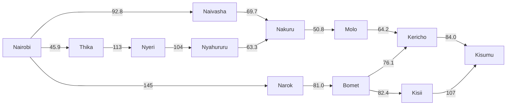
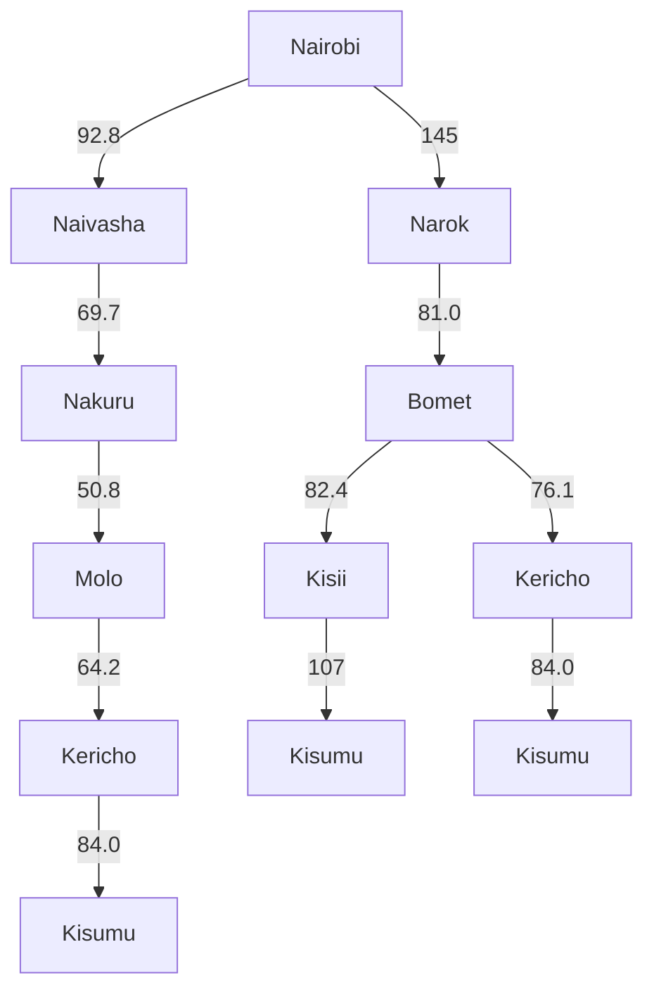

# Practical Exercise 3: Designing a Searching Agent

**Course:** ICS 3202 Artificial Intelligence
**Group:** ICS 3.2E
**Members:** Waweru Collins Wambugu (191335), Sinai Mattah Msereke (190525)

## Evidence of Groupwork

<!-- Team photo, all faces visible. Save it in the repo (e.g. /images/team.jpg) -->

---

## 1. PEAS Design: Self-Driving Trailer

Our agent is a self-driving trailer that hauls cargo from Nairobi to Kisumu on Kenya's highways.

| | Description |
|---|---|
| **Performance measure** | Shortest total distance, safe arrival, low fuel use, cargo delivered undamaged, and following traffic law |
| **Environment** | Highways and towns between Nairobi and Kisumu; matatus, buses, trucks and cars; boda bodas, pedestrians and animals; weather and road condition; traffic police and checkpoints; road signs and speed limits |
| **Actuators** | Steering wheel, accelerator, brake, indicators, headlights, horn |
| **Sensors** | GPS, cameras, radar and sonar, speedometer, odometer, fuel gauge |

### Environment classification

| Property | Classification | Reason |
|---|---|---|
| Observable | Partially observable | The sensors only cover what is nearby. The trailer can't see a jam, an accident or a pothole past the next bend. |
| Deterministic | Stochastic | Some of what happens next is out of the trailer's hands. A matatu can cut in front or it can start raining, so the same action doesn't always give the same result. |
| Episodic | Sequential | Every turn, speed change or overtake changes where the trailer is for the next decision. Choices build on earlier ones. |
| Static | Dynamic | Traffic, weather and the road keep changing while the trailer is still deciding. |
| Agents | Multi-agent | Other drivers, cyclists, boda bodas and pedestrians all act on their own goals on the same road. |

---

## 2. Directed Graph and Search Tree

### Abstraction decisions

The map is big, so we only kept what helps the trailer get from Nairobi to Kisumu.

- **Towns left out:** Meru, Embu, Isiolo, Nanyuki, Eldoret and Webuye. They lead away from Kisumu or sit on no sensible route to it, so they could never end up on a solution.
- **Direction of edges:** Roads can be driven both ways, but the trailer only ever needs to go toward Kisumu. We drew every edge one way, which also stops the agent from looping back to a town it has already visited.
- **Nyeri branch pruned from the tree:** The route through Thika, Nyeri and Nyahururu stays in the graph to show we considered it. We dropped it from the search tree because at 525.2 km it is much longer than the other routes.
- **Costs:** Each edge is labelled with the road distance in km from Google Maps, since path cost here is distance.

### Directed graph (edges point toward Kisumu, labelled in km)

### Search tree (root = initial state, leaves = goal state)

*The Thika, Nyeri, Nyahururu branch is only in the graph. We left it out of the tree (see the abstraction notes above).*

---

## 3. Optimal Path (path cost = distance)

### Distances between towns (Google Maps, rounded)

| From | To | Distance (km) |
|---|---|---|
| Nairobi | Naivasha | 92.8 |
| Naivasha | Nakuru | 69.7 |
| Nakuru | Molo | 50.8 |
| Molo | Kericho | 64.2 |
| Kericho | Kisumu | 84.0 |
| Nairobi | Narok | 145 |
| Narok | Bomet | 81.0 |
| Bomet | Kisii | 82.4 |
| Kisii | Kisumu | 107 |
| Bomet | Kericho | 76.1 |
| Nairobi | Thika | 45.9 |
| Thika | Nyeri | 113 |
| Nyeri | Nyahururu | 104 |
| Nyahururu | Nakuru | 63.3 |

### Total cost per route

| Route | Calculation | Total (km) |
|---|---|---|
| Nairobi → Naivasha → Nakuru → Molo → Kericho → Kisumu | 92.8 + 69.7 + 50.8 + 64.2 + 84.0 | **361.5** |
| Nairobi → Narok → Bomet → Kericho → Kisumu | 145 + 81.0 + 76.1 + 84.0 | 386.1 |
| Nairobi → Narok → Bomet → Kisii → Kisumu | 145 + 81.0 + 82.4 + 107 | 415.4 |
| Nairobi → Thika → Nyeri → Nyahururu → Nakuru → Molo → Kericho → Kisumu | 45.9 + 113 + 104 + 63.3 + 50.8 + 64.2 + 84.0 | 525.2 |

### Optimal path

The cheapest route is **Nairobi → Naivasha → Nakuru → Molo → Kericho → Kisumu** at **361.5 km**. The next best is Nairobi → Narok → Bomet → Kericho → Kisumu at 386.1 km, which is 24.6 km longer.